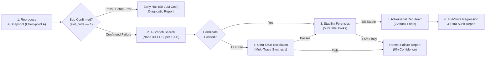
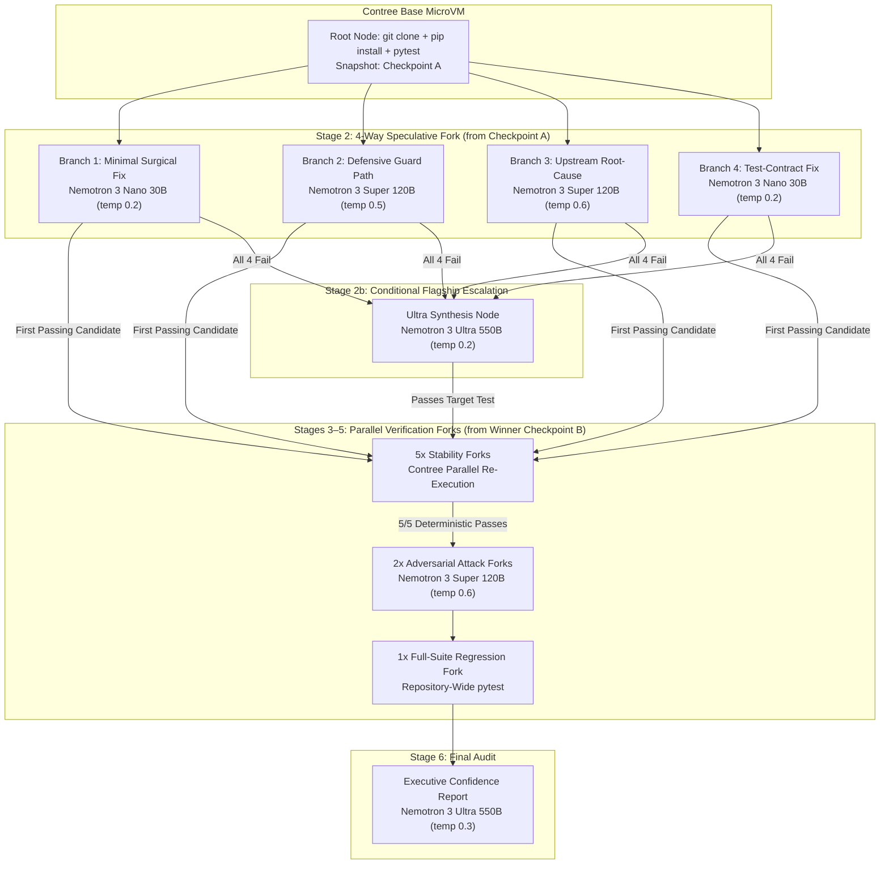

<div align="center">

# PatchTree

**Autonomous Code Verification & Speculative Repair Engine for Python Codebases**

*CI/CD-Adjacent Speculative Verification Agent with Multi-Stage Sandbox Forking*

<p align="center">
  <a href="./LICENSE"></a>
  
  
  
  
  
  
</p>

<p align="center">
  <a href="#executive-summary">Executive Summary</a> ·
  <a href="#the-core-problem-vs-the-patchtree-solution">Problem & Solution</a> ·
  <a href="#architecture--verification-pipeline">Architecture</a> ·
  <a href="#interactive-mission-control-ui">Mission Control UI</a> ·
  <a href="#curated-benchmark-scenarios">Benchmark Scenarios</a> ·
  <a href="#quickstart-for-judges--developers">Quickstart</a> ·
  <a href="#tech-stack--cloud-infrastructure">Tech Stack</a> ·
  <a href="./LICENSE">License</a>
</p>

</div>

<!-- Demo GIF placeholder for final submission:
<p align="center">
  
</p>
-->

---

## Executive Summary

**PatchTree** is an autonomous verification and speculative repair tool purpose-built for **Python codebases** (Python 3.10–3.13+). It functions as a **CI/CD-adjacent speculative verification agent** that developers and automated systems can trigger via API or Web UI to safely isolate, reproduce, and repair regressions in isolated cloud sandboxes.

Built for native Python tooling first, PatchTree supports:
- **Test Frameworks:** `pytest`, `unittest`
- **Package Manifests:** `requirements.txt`, `pyproject.toml`, `setup.py`
- **Execution Environment:** Copy-on-write Linux microVMs on **Nebius Contree**
- **Inference Engine:** Tiered LLM ensemble using **NVIDIA Nemotron 3 Family** (Nano 30B, Super 120B, Ultra 550B) via **Nebius Token Factory**

Rather than operating as a general-purpose coding assistant, PatchTree is architected as an **engineering tool**: a production-grade verification pipeline designed to augment existing CI/CD workflows with speculative tree exploration, adversarial boundary testing, and stability forensics across 13+ isolated sandbox forks.

---

## The Core Problem vs. The PatchTree Solution

### How Standard AI Coding Agents Fail

Single-shot coding agents (sweepers, copilots, linear repair loops) operate in a guess-and-check paradigm that breaks down predictably in production codebases:

1. **Single-Hypothesis Trap:** Agents lock into localized syntax edits at the crash site rather than tracing architectural root causes upstream through caller chains or data producers.

2. **Reward-Hacking & Test Corruption:** Models frequently achieve "green" test suites by modifying or deleting `assert` statements inside `test_*.py` files rather than fixing the actual implementation—a form of specification gaming that silently erodes test integrity.

3. **Flaky False-Positives:** Assuming that a single passing test execution means the code is deterministically fixed. Race conditions, async timing jitter, memory state leaks, or uninitialized variables can produce transient passes that mask underlying defects.

4. **Blind Patch Application:** Agents apply diffs without verifying line endings, import side effects, or full-suite regression boundaries, introducing breaking changes to unrelated modules.

### How PatchTree Fundamentally Solves This

**PatchTree** replaces single-shot patching with **speculative tree exploration over real copy-on-write microVM sandboxes**. Given a repository URL, bug description, and test command, PatchTree:

1. Boots a base `python:3.11` microVM on **Nebius Contree** (isolated copy-on-write Linux sandbox)
2. Reproduces the failure with zero-LLM checkpoint-based validation
3. Snapshots the container filesystem with **git-level checkpoint isolation**
4. Executes **in-sandbox AST Context Slicing** (`context_engine.py`) with line-level call graph resolution
5. Fans out an execution tree of **13+ isolated microVM nodes** powered by a tiered **NVIDIA Nemotron 3** ensemble (Nano 30B, Super 120B, Ultra 550B) via **Nebius Token Factory**
6. Enforces strict **anti-test-tampering guardrails** (code modifications restricted to non-test source files)
7. Validates stability via **5-fork parallel forensics** (5/5 clean passes required)
8. Hardens boundaries with **2-fork adversarial red-teaming** (synthesizing attack test suites)
9. Escalates to **Nemotron 3 Ultra (550B)** when lightweight models fail, analyzing all prior failed diffs and tracebacks

This approach transforms unreliable guess-and-check into deterministic, auditable verification.

### Core Comparative Matrix: Single-Shot Agents vs. PatchTree

| Capability | Single-Shot Coding Agents | PatchTree |
|---|---|---|
| **Hypothesis Exploration** | Sequential, single-strategy retries | **4-Branch Concurrent Search** across distinct repair strategies (Minimal Surgical, Defensive Boundary, Upstream Root-Cause, Test-Driven Contract) |
| **Source Context** | Raw file dumps or ungrounded line guesses | **In-Sandbox AST Context Engine** (`context_engine.py`) with line-level call-graph resolution |
| **Test Integrity** | Unconstrained file edits | **Anti-Reward-Hacking Policy**: code modifications restricted to non-test source files (`test_*.py` and `tests/*` are read-only) |
| **Execution Isolation** | Mutates a single working tree | **Contree OCI Checkpointing & Copy-on-Write Forking** with git-level filesystem snapshotting |
| **Flakiness Detection** | Assumes 1 green run = deterministic fix | **5-Fork Parallel Stability Forensics** (5/5 passes required to eliminate flaky flukes) |
| **Edge-Case Hardening** | None | **2-Fork Adversarial Red-Teaming** (synthesizes new boundary `pytest` suites to verify resilience) |
| **Failure Recovery** | Blind retries with the same prompt | **Nemotron 3 Ultra (550B) Escalation** analyzing all prior failed diffs and tracebacks |
| **Deliverable** | Unverified diff | **Verified Unified Diff + Weighted Confidence Score + Executive Audit Report + One-Click `.patch` Download** |

---

## Architecture & Verification Pipeline

PatchTree executes a six-stage state machine orchestrated by FastAPI (`Backend/app/orchestrator/pipeline.py`) and rendered in real time as a directed acyclic graph (DAG) in the React Flow Mission Control UI (`Frontend/src/App.tsx`).



### Stage Breakdown

1. **Reproduction & Baseline Checkpointing (`ReproduceNode`)**
   - Spawns a `python:3.11` microVM on Nebius Contree, clones the target repository into `/app`, discovers and installs dependency manifests (`requirements.txt`, `pyproject.toml`, or `setup.py`), and executes the target `pytest` command.
   - **Zero-LLM Early-Stop Guard:** If the repository cannot be cloned, lacks dependency manifests, fails collection, or if the target test already passes (`exit_code == 0`), PatchTree halts immediately before making any LLM calls (`$0.00` token cost) and returns a diagnostic report.
   - Once the failure is confirmed, PatchTree captures **Checkpoint A** (`checkpoint_id = sandbox.checkpoint()`).

2. **In-Sandbox AST Context Slicing (`context_engine.py`)**
   - Before prompting any repair model, PatchTree runs an AST dependency and stack-trace analyzer inside the sandbox (`python3 /usr/local/bin/context_engine.py --repo /app --budget 3000`).
   - It extracts the crashing function, enclosing class definitions, and upstream caller/producer functions, formatting them with exact 1-based line numbers (`<line_number> | <code>`) so models generate valid `@@ -start,count +start,count @@` unified diff headers.

3. **4-Branch Concurrent Search (`search_round`)**
   - Forks 4 independent sandboxes from Checkpoint A in parallel, pairing each branch with a specialized repair strategy and model tier:
     - **Branch 1 (`generate_patch_minimal`):** Routed to **Nemotron 3 Nano (30B)** at `temp=0.2`. Generates a minimal 1–5 line surgical fix at the crash site.
     - **Branch 2 (`generate_patch_alternative`):** Routed to **Nemotron 3 Super (120B)** at `temp=0.5`. Introduces defensive guard clauses, boundary validation, or state normalization.
     - **Branch 3 (`generate_patch_root_cause`):** Routed to **Nemotron 3 Super (120B)** at `temp=0.6`. Traces invalid state upstream into producer functions or class initialization.
     - **Branch 4 (`generate_patch_test_driven`):** Routed to **Nemotron 3 Nano (30B)** at `temp=0.2`. Aligns return types, side effects, and exception contracts with the test specification.

4. **Nemotron 3 Ultra (550B) Escalation (`ultra_synthesize_patch`)**
   - Triggered only if all 4 initial search branches fail.
   - Expands the AST context window (`--budget 4500 --profile wide`) and feeds all 4 failed diffs alongside their resulting `git apply` or `pytest` tracebacks to **Nemotron 3 Ultra (550B)** (`temp=0.2`) to synthesize a corrective multi-hunk patch.

5. **Flaky-Test Forensics (`check_stability`)**
   - Forks the winning candidate's checkpoint $k=5$ times in parallel and re-executes the target test across all 5 isolated microVMs.
   - A candidate is marked `is_stable = True` only if all **5/5 forks pass**. Flaky candidates are demoted automatically.

6. **Adversarial Verification (`check_adversarial`) & Full-Suite Regression (`run_full_suite`)**
   - Forks the stability-verified checkpoint $m=2$ times. **Nemotron 3 Super (120B)** inspects the candidate diff and writes standalone `pytest` attack modules (`test_adversarial_check.py`) probing boundary values (zero, negative inputs, `None`, float precision, empty collections).
   - Optionally runs the full repository test suite (`full_suite_test`) on a separate fork to verify zero regressions, then dispatches **Nemotron 3 Ultra (550B)** to compile the final **Executive Confidence Report**.

---

## NVIDIA Nemotron 3 & Nebius Token Factory Integration

> *Built for the **Nebius x NVIDIA Global AI Hackathon** — **Coding and Agentic Engineering Track**.*

PatchTree leverages the **NVIDIA Nemotron 3 model family** (Nano 30B, Super 120B, Ultra 550B) hosted on **Nebius Token Factory** to implement cost-aware tiered routing across the verification pipeline.

### 1. Sandbox Forking & Model Routing Topology



### 2. Tiered Model Routing & Token Economics (`Backend/app/llm/router.py`)

By routing high-volume tasks to **Nemotron 3 Nano (30B)** and **Super (120B)** over persistent HTTP/2 connections and reserving **Nemotron 3 Ultra (550B)** strictly for escalation and final auditing, PatchTree maintains average full-pipeline token costs between **$0.004 and $0.04 per run**:

| Tier | Model Identifier on Nebius Token Factory | Pricing (per 1M tokens) | Assigned Pipeline Jobs | Default Temp |
|---|---|---|---|---|
| **Nano** | `nvidia/NVIDIA-Nemotron-3-Nano-30B-A3B` | `$0.10` | `generate_patch_minimal`, `generate_patch_test_driven` | `0.2` |
| **Super** | `nvidia/nemotron-3-super-120b-a12b` | `$0.35` | `generate_patch_alternative`, `generate_patch_root_cause`, `generate_adversarial_test` | `0.5` – `0.6` |
| **Ultra** | `nvidia/Nemotron-3-Ultra-550b-a55b` | `$1.20` | `ultra_synthesize_patch`, `replan_after_failure`, `generate_confidence_report` | `0.2` – `0.3` |

**Cost Efficiency:** A typical run invoking 4 search branches (2 Nano + 2 Super), 5 stability forks (sandbox-only, no LLM), 2 adversarial generators (Super), and 1 Ultra audit report costs approximately **$0.008–$0.015** in total LLM inference.

### 3. Weighted Confidence Score Calculation

After all verification stages complete, PatchTree computes a weighted confidence percentage:

```python
# When full_suite_test is provided (full-suite regression enabled):
confidence_score = (
    0.40 * (stability_passes / 5) +           # 40% weight: deterministic stability
    0.40 * (adversarial_survived / 2) +       # 40% weight: boundary resilience
    0.20 * (1.0 if full_suite_pass else 0.0)  # 20% weight: zero regressions
)

# When full_suite_test is omitted (targeted test mode):
confidence_score = (
    0.50 * (stability_passes / 5) +           # 50% weight: deterministic stability
    0.50 * (adversarial_survived / 2)         # 50% weight: boundary resilience
)
```

A score of **100%** indicates the patch passed all 5 stability forks, survived all 2 adversarial attacks, and (if enabled) passed the full repository test suite with zero regressions.

---

## Interactive Mission Control UI

PatchTree's frontend is built with **React 19 + TypeScript + Vite** and provides a production-grade Mission Control interface for real-time visualization and telemetry:

### Key Features

- **Interactive React Flow DAG Visualization:** Renders every speculative sandbox fork, phase transition, and node state in real time as an animated directed acyclic graph. Nodes update live as sandboxes transition through `pending → running → passed/failed` states.

- **Full Node Inspector & Diff Telemetry:** Click any node to open a slide-over drawer exposing:
  - **Unified Diff View:** Syntax-highlighted `@@ -start,count +start,count @@` hunks with line-by-line additions/deletions
  - **Terminal Execution Output:** Raw `stdout`/`stderr` from `pytest` execution, `git apply`, and sandbox commands
  - **Token Consumption & Wall Time:** Exact token counts per LLM call and execution duration per node

- **Confidence Report & Audit Modal:** After pipeline completion, generates an actionable post-mortem report including:
  - Weighted confidence percentage (`stability_passes / 5 * 0.5 + adversarial_survived / 2 * 0.5`)
  - Stability metrics (5/5 deterministic pass gauge)
  - Adversarial attack results (boundary value resilience)
  - One-click `.patch` file download for immediate `git apply`
  - Executive summary authored by **Nemotron 3 Ultra (550B)**

- **Pre-Loaded Benchmark Launchpad:** Quick-fill templates for three curated real-world scenarios (see [Curated Benchmark Scenarios](#curated-benchmark-scenarios) below)

- **Production Deployment:** Hosted on Vercel with resilient backend proxying to Render, supporting WebSocket-like long-polling for sub-second node updates

### Architecture

```text
Frontend (React 19 + TypeScript + Vite)
├── React Flow Canvas (DAG tree rendering)
├── TopBar (repo breadcrumb, pipeline stage ribbon, cost telemetry)
├── Launchpad (benchmark scenario selector, custom repo input)
├── PNode (custom React Flow node cards with stability bars)
├── ParticleEdge (animated SVG edges for active execution paths)
├── NodeInspector (slide-over drawer for diffs, logs, metrics)
├── ReportModal (confidence gauge, Markdown audit viewer, .patch download)
└── NewRunModal (run submission with quick-fill templates)
```

---

## Curated Benchmark Scenarios

For the convenience of hackathon judges and live demo evaluations, **pre-loaded real-world benchmark examples** are integrated directly into the Web UI Launchpad. These scenarios demonstrate PatchTree's capabilities across different bug classes and model tiers:

### 1. **E-Commerce Volume Discount Bug** (`noshaeec/checkout-pricing-suite`)
- **Bug Class:** Off-by-one boundary condition (`>` vs `>=` in volume discount threshold)
- **Model Tier:** Resolved by **Nemotron 3 Nano (30B)** in Branch 1 (Minimal Surgical Fix)
- **Execution Time:** ~58 seconds
- **Token Cost:** <$0.01
- **Demonstrates:** Zero-LLM early-stop validation, AST context slicing, single-hunk surgical repair

### 2. **Task Management API Crash** (`GHOST4709/BackendTestRun`)
- **Bug Class:** Unhandled `ZeroDivisionError` in empty-workspace calculation
- **Model Tier:** Resolved by **Nemotron 3 Super (120B)** in Branch 2 (Defensive Guard Path)
- **Demonstrates:** Defensive boundary validation, 5-fork stability forensics, adversarial red-teaming with edge-case synthesis

### 3. **Traffic Law Microservice** (`GHOST4709/drivelegal`)
- **Bug Class:** Multi-file state inconsistency requiring upstream root-cause analysis
- **Model Tier:** Required **Nemotron 3 Ultra (550B)** escalation after all 4 initial branches failed
- **Demonstrates:** Multi-trace synthesis across failed diffs, wide AST context window expansion, full-suite regression verification

**Beyond Benchmarks:** PatchTree's pipeline has been battle-tested across multiple external production codebases and real-world FastAPI/Flask repositories to empirically validate multi-file context discovery, git-level patch application, and regression-free test passes.

**For Judges:** Click **"Load"** on any benchmark scenario to instantly explore a complete 13-node execution tree, or paste any arbitrary public Python GitHub repository URL into the **"+ New Run"** modal to trigger a live cloud sandbox verification.

---

## Repository Structure

```text
PatchTree/
├── Backend/
│   ├── app/
│   │   ├── main.py                      # FastAPI application, rate limiters & REST endpoints
│   │   ├── orchestrator/
│   │   │   ├── pipeline.py              # Async repair pipeline, prompts & verification stages
│   │   │   └── context_engine.py        # AST stack-trace analyzer & context budget packer
│   │   ├── llm/
│   │   │   └── router.py                # HTTP/2 tiered model router for Nebius Token Factory
│   │   ├── sandbox/
│   │   │   └── contree_client.py        # Nebius Contree microVM manager + offline stub mode
│   │   ├── models/
│   │   │   └── schemas.py               # Pydantic v2 schemas (Run, Node, RunCreate)
│   │   └── db/
│   │       └── client.py                # Supabase (PostgreSQL) persistence + in-memory store
│   ├── tests/                           # Offline unit, real-git integration & live smoke tests
│   ├── requirements.txt
│   └── .env.example
├── Frontend/
│   ├── src/
│   │   ├── App.tsx                      # React Flow DAG canvas, live polling & state manager
│   │   ├── patchtree-hud.css            # Mission Control HUD & telemetry bar styles
│   │   └── components/
│   │       ├── TopBar.tsx               # Top HUD bar, repo breadcrumb & pipeline stage ribbon
│   │       ├── Launchpad.tsx            # Benchmark scenario selector & custom repo input
│   │       ├── PNode.tsx                # Custom React Flow node cards with stability bars
│   │       ├── ParticleEdge.tsx         # Animated SVG edges indicating active execution paths
│   │       ├── NodeInspector.tsx        # Slide-over drawer (Unified Diff, Pytest Output, Telemetry)
│   │       ├── ReportModal.tsx          # Confidence gauge & Markdown report viewer
│   │       └── NewRunModal.tsx          # Run submission modal with quick-fill templates
│   └── package.json
├── docs/                                # Architecture & engineering design documents
├── LICENSE                              # Mozilla Public License 2.0 (MPL-2.0)
└── README.md
```

---

## Quickstart for Judges & Developers

PatchTree is built as an **open-source verification engine** that can be evaluated either via the **hosted web workbench** (for immediate hackathon judging) or **self-hosted locally** with your own API keys.

### 1. Hosted Web Workbench (Zero-Setup Evaluation for Judges)

**Recommended for hackathon judges and immediate evaluation.**

1. **Access the Live Demo:** Open the hosted deployment URL from the Devpost submission page (deployed on Vercel)

2. **Instant Benchmark Replay (`$0.00` Cost):**
   - On the Launchpad, select any of the three curated benchmark scenarios:
     - **E-Commerce Discount Bug** (*Nano 30B surgical fix, ~58s, <$0.01*)
     - **Task API Crash** (*Super 120B defensive guards + stability forensics*)
     - **Traffic Law Microservice** (*Ultra 550B escalation + full-suite regression*)
   - Click **"Load"** to instantly inspect a complete 13-node execution tree with diffs, logs, and telemetry
   - Explore the architecture: click nodes to view unified diffs, pytest output, token consumption, and wall times

3. **Live Cloud Sandbox Execution (`+ New Run`):**
   - Click **"+ New Run"** in the top navigation bar
   - Enter a public Python GitHub repository URL (e.g., `https://github.com/owner/repo`)
   - Provide a bug description and `pytest` command (e.g., `pytest tests/test_checkout.py::test_volume_discount`)
   - Watch Contree sandboxes and Nemotron models execute the 6-stage pipeline live
   - Monitor the React Flow DAG as nodes transition through `pending → running → passed/failed` states in real time

### 2. Local Installation (Self-Hosted with Your Own Keys)

**For developers who want to run PatchTree locally or integrate it into their own workflows.**

#### Prerequisites
- **Python 3.10–3.13+** and **Node.js 18+**
- **Nebius Token Factory API Key** (`NEBIUS_API_KEY`) and **Contree Project ID** (`NEBIUS_PROJECT_ID`) for live cloud microVM execution
  
  *(Note: If credentials are omitted, PatchTree automatically falls back to **deterministic local simulation mode** so the full 13-node pipeline and UI can be tested offline at `$0.00` cost with synthetic execution traces.)*

#### Step 1 — Start the Backend API (`http://localhost:8000`)

```bash
git clone https://github.com/your-org/PatchTree.git
cd PatchTree/Backend

python -m venv venv
# Windows (PowerShell):
.\venv\Scripts\Activate.ps1
# Linux / macOS:
source venv/bin/activate

pip install -r requirements.txt
cp .env.example .env
```

Configure `Backend/.env`:

```ini
# Nebius Token Factory & Contree Cloud Sandboxes
NEBIUS_API_KEY="your_nebius_token_factory_api_key"
NEBIUS_PROJECT_ID="your_contree_project_id"
CONTREE_BASE_URL="https://api.contree.nebius.com"

# Optional: Supabase Persistence (uses in-memory store if omitted)
SUPABASE_URL="https://your-project.supabase.co"
SUPABASE_SERVICE_ROLE_KEY="your_supabase_service_role_key"

# Concurrency & Budget Protections
MAX_CONCURRENT_RUNS=1
MAX_DAILY_RUNS=50
```

Launch the FastAPI server:

```bash
uvicorn app.main:app --reload --port 8000
```

Interactive OpenAPI documentation will be available at `http://localhost:8000/docs`.

#### Step 2 — Start the Frontend UI (`http://localhost:5173`)

```bash
cd ../Frontend
npm install
npm run dev
```

Open `http://localhost:5173` in your browser. The UI will connect to the local backend at `http://localhost:8000`.

#### Step 3 — Run the Test Suite

```bash
cd ../Backend

# Fast offline unit + real local-git integration suite (~12s, $0.00 cost, 0 network calls):
python -m pytest tests/ -q

# Optional live smoke suite (verifies live Nebius Token Factory + Contree credentials):
# PowerShell:
$env:RUN_LIVE_SMOKE="1"; python -m pytest tests/test_contree.py tests/test_nebius.py -q
# Bash:
RUN_LIVE_SMOKE=1 python -m pytest tests/test_contree.py tests/test_nebius.py -q
```

---

## Tech Stack & Cloud Infrastructure

PatchTree is built on a modern, production-grade technology stack optimized for cost efficiency, execution isolation, and real-time visualization:

### Backend Architecture

| Component | Technology | Purpose |
|---|---|---|
| **Application Framework** | Python 3.11+, FastAPI, Pydantic v2 | Async REST API, request validation, type-safe schemas |
| **Concurrency Runtime** | AnyIO + asyncio | Async orchestration, parallel sandbox forking |
| **Database & Persistence** | Hosted Supabase (PostgreSQL) + in-memory fallback | Run metadata storage, node state persistence |
| **LLM Inference Engine** | NVIDIA Nemotron 3 Family (Nano 30B, Super 120B, Ultra 550B) | Tiered model routing for cost-optimized repair generation |
| **Inference Gateway** | Nebius Token Factory (HTTP/2 streaming) | Unified OpenAI-compatible endpoints with transparent model routing |
| **Execution Sandboxes** | Nebius Contree (OCI Linux microVMs) | Copy-on-write filesystem checkpointing, git-level isolation |
| **Code Context Analysis** | Custom AST Parser (`context_engine.py`) | Stack-trace analyzer, call-graph resolver, context budget packer |

### Frontend Architecture

| Component | Technology | Purpose |
|---|---|---|
| **UI Framework** | React 19, TypeScript | Type-safe component architecture, modern hooks API |
| **Build Tool** | Vite | Sub-second HMR, optimized production builds |
| **DAG Visualization** | React Flow | Interactive node graph canvas, custom node/edge rendering |
| **State Management** | React hooks (`useState`, `useEffect`, `useMemo`) | Local state, API polling, derived computations |
| **Icons & UI Kit** | Lucide Icons | Consistent vector iconography |
| **Styling** | CSS Modules + `patchtree-hud.css` | Mission Control HUD theme, terminal aesthetics |

### Cloud Infrastructure & Deployment

| Service | Platform | Purpose |
|---|---|---|
| **Frontend Hosting** | Vercel | Static asset CDN, edge routing, sub-100ms TTFB |
| **Backend Hosting** | Render | Managed Python container, auto-scaling, health checks |
| **Database** | Supabase (hosted PostgreSQL) | Persistent run metadata, node state snapshots |
| **Sandboxes** | Nebius Contree | Isolated copy-on-write Linux microVMs with git checkpointing |
| **LLM Inference** | Nebius Token Factory | HTTP/2 streaming to NVIDIA Nemotron 3 ensemble |

### Cost Optimization & Token Economics

By routing high-volume tasks to **Nemotron 3 Nano (30B)** and **Super (120B)** over persistent HTTP/2 connections and reserving **Nemotron 3 Ultra (550B)** strictly for escalation and final auditing, PatchTree maintains average full-pipeline token costs between **$0.004 and $0.04 per run**:

| Tier | Model on Nebius Token Factory | Pricing (per 1M tokens) | Pipeline Jobs | Default Temp |
|---|---|---|---|---|
| **Nano** | `nvidia/NVIDIA-Nemotron-3-Nano-30B-A3B` | `$0.10` | Minimal surgical fixes, test-driven contracts | `0.2` |
| **Super** | `nvidia/nemotron-3-super-120b-a12b` | `$0.35` | Defensive guards, root-cause analysis, adversarial synthesis | `0.5` – `0.6` |
| **Ultra** | `nvidia/Nemotron-3-Ultra-550b-a55b` | `$1.20` | Multi-trace escalation, replanning, confidence reports | `0.2` – `0.3` |

---

## Security, Isolation & Anti-Cheating Guardrails

PatchTree enforces multiple layers of security and integrity protections to prevent test corruption, resource exhaustion, and malicious execution:

### Sandboxed Execution Isolation

- **Nebius Contree OCI Containers:** Every repair attempt executes in a disposable, copy-on-write Linux microVM with no access to the host filesystem, network APIs, or sibling sandboxes.
- **Checkpoint-Based Forking:** All speculative branches fork from immutable checkpoints (`checkpoint_id = image.checkpoint()`), preventing cross-contamination between concurrent search paths.
- **Resource Limits:** Each sandbox enforces CPU, memory, and wall-time quotas to prevent runaway processes or fork bombs.

### Read-Only Test Policy (Anti-Reward-Hacking)

- **Test File Write Protection:** PatchTree's prompt engineering and post-generation validation explicitly prohibit modifications to:
  - Files matching `test_*.py`, `*_test.py`
  - Any file under `tests/`, `test/`, `__tests__/` directories
- **Diff Validation:** Before applying any patch, `pipeline.py` parses the unified diff headers and rejects patches targeting test files with an explicit failure reason.

### Cost & Abuse Controls

When deployed publicly (e.g., on Render or Vercel), PatchTree enforces multi-layer protections:

- **Zero-LLM Early Halt:** Repository clone errors, missing dependency manifests (`requirements.txt`, `pyproject.toml`, `setup.py`), `pytest` collection errors, or tests that already pass (`exit_code == 0`) abort immediately at the Root Node before any Nebius Token Factory call is made (`$0.00` cost).
- **Per-Run LLM Circuit Breaker:** Each run is hard-capped at a maximum of 8 LLM calls (4 search branches + 1 optional Ultra synthesis + 2 adversarial generators + 1 confidence report).
- **Concurrency Locks:** Enforces `MAX_CONCURRENT_RUNS` in-flight run limits per backend instance.
- **Rate Limiting:** Per-IP request throttling (10 requests/minute) and daily run caps (`MAX_DAILY_RUNS=50`) to prevent automated credit exhaustion.

---

## Roadmap

PatchTree is architected as a modular verification engine. Planned extensions beyond the web workbench include:

- **IDE Extensions & MCP Server (VS Code, Cursor, Antigravity):** Expose the PatchTree verification pipeline as a Model Context Protocol (MCP) server and IDE extension, allowing developers to trigger a 4-branch Contree verification run directly from a failing test in their editor and apply the winning diff in one click.
- **GitHub Actions CI/CD App (`patchtree-bot`):** Automatically trigger PatchTree when a pull request fails CI checks, posting the stability-verified diff and Nemotron Ultra Confidence Report directly as a PR review comment.
- **Multi-Language Contree OCI Images:** Extend base sandbox images beyond Python (`pytest`) to support TypeScript/Node.js (`vitest` / `jest`), Go (`go test`), and Rust (`cargo test`).

---

## Platform Feedback: Nebius Token Factory, Contree & NVIDIA Nemotron

*(Provided per hackathon submission guidelines)*

1. **Nebius Token Factory:**
   - **Strengths:** Unified OpenAI-compatible endpoints across the **NVIDIA Nemotron 3** family (`Nano 30B`, `Super 120B`, `Ultra 550B`) made building a cost-aware model router straightforward. Routing initial search branches to Nano (`$0.10/1M`) and Super (`$0.35/1M`) while reserving Ultra (`$1.20/1M`) for cross-branch failure synthesis reduced per-run inference costs by ~80%.
   - **Feature Request:** Native support for grammar-constrained decoding (e.g., enforcing unified diff syntax at the token-sampling level) on the Nano 30B endpoint would eliminate occasional diff header formatting errors without prompt overhead.
2. **Nebius Contree Sandbox SDK:**
   - **Strengths:** Copy-on-write image checkpointing (`image.run(..., disposable=False)` returning an immutable image UUID reusable via `client.images.use(checkpoint_id)`) is ideal for tree-search agents. It allowed 13+ nodes across search, stability, and adversarial stages to fork from a pre-installed dependency snapshot in milliseconds rather than repeating `git clone` and `pip install`.
   - **Feature Request:** A native `image.write_file(path, bytes)` SDK method would simplify injecting generated diffs and test files without base64 shell piping.
3. **NVIDIA Nemotron 3 Models:**
   - **Nemotron 3 Super (120B)** performed strongly on adversarial red-teaming, reliably identifying edge cases (negative inputs, boundary thresholds, empty iterables) missed by initial patches.
   - **Nemotron 3 Ultra (550B)** demonstrated strong multi-trace reasoning when synthesizing a unified fix from four prior failed diffs and their `pytest` tracebacks.

---

## License

Released under the [Mozilla Public License 2.0 (MPL-2.0)](./LICENSE).
