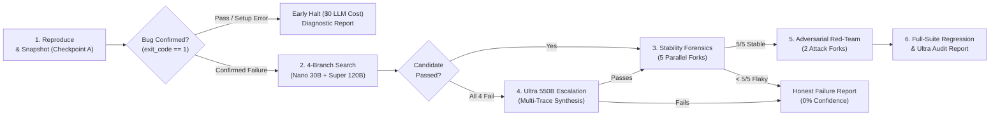
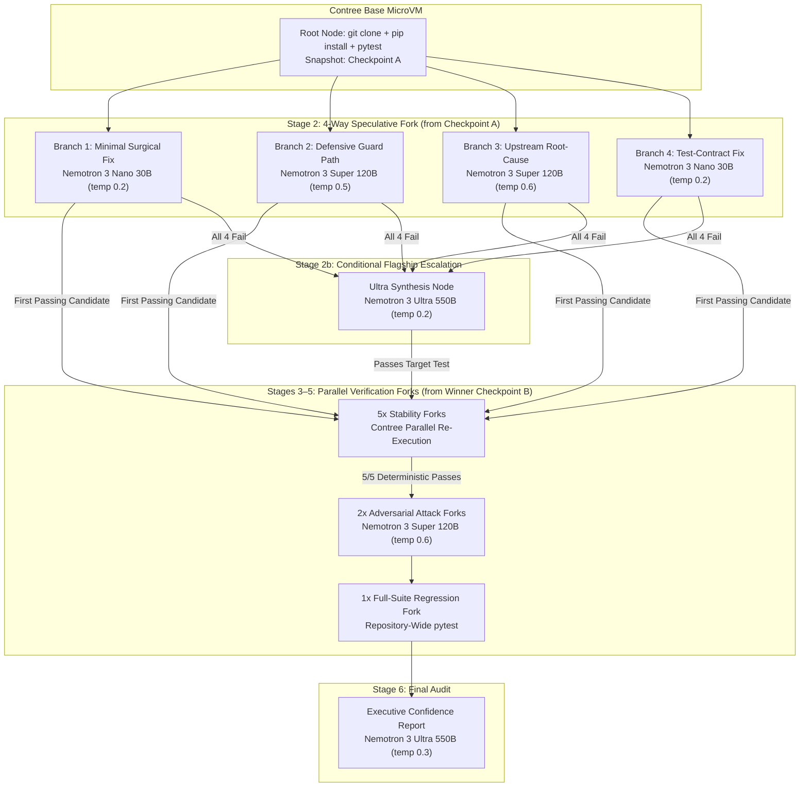

<div align="center">

# PatchTree

**Speculative Sandbox Forking & Multi-Stage Verification Engine for Autonomous Code Repair**

<p align="center">
  <a href="./LICENSE"></a>
  
  
  
  
  
</p>

<p align="center">
  <a href="#overview">Overview</a> ·
  <a href="#architecture--verification-pipeline">Architecture</a> ·
  <a href="#nvidia-nemotron--nebius-token-factory-integration">Nemotron & Nebius Integration</a> ·
  <a href="#getting-started">Getting Started</a> ·
  <a href="#roadmap">Roadmap</a> ·
  <a href="./LICENSE">License</a>
</p>

</div>

<!-- Demo GIF placeholder for final submission:
<p align="center">
  
</p>
-->

---

## Overview

Standard autonomous coding agents operate in a linear, single-threaded loop: read a stack trace, generate a single candidate diff, run the target test once, and return the result. In production codebases, this approach fails in four predictable ways:

1. **Single-hypothesis lock-in:** A localized symptom patch fails when the defect originates in an upstream caller or data producer.
2. **Reward hacking:** Models frequently pass a failing test suite by weakening, deleting, or bypassing `assert` statements inside the test file rather than fixing the implementation.
3. **Flaky false positives:** Race conditions, async timing jitter, or shared state allow defective patches to pass a single test execution by chance.
4. **Overfitted patches:** A candidate fix can satisfy the named test case while failing on boundary inputs (`0`, `None`, negative values, empty collections) or introducing regressions elsewhere in the repository.

**PatchTree** replaces single-shot patching with **speculative execution over copy-on-write cloud sandboxes**. Given a repository URL, bug description, and test command, PatchTree boots a base microVM on **Nebius Contree**, reproduces the failure, snapshots the container filesystem, and fans out an execution tree of **13+ isolated microVM nodes** driven by the **NVIDIA Nemotron 3** model family on **Nebius Token Factory**.

| Capability | Single-Shot Coding Agents | PatchTree |
|---|---|---|
| **Hypothesis Exploration** | Sequential, single-strategy retries | **4-Branch Concurrent Search** across distinct repair strategies |
| **Source Context** | Raw file dumps or ungrounded line guesses | **In-Sandbox AST Context Engine** (`context_engine.py`) with call-graph ranking |
| **Test Integrity** | Unconstrained file edits | **Anti-Reward-Hacking Policy** prohibiting edits to `test_*.py` and `tests/*` |
| **Execution Isolation** | Mutates a single working tree | **Contree OCI Checkpointing & Copy-on-Write Forking** |
| **Flakiness Detection** | Assumes 1 green run = deterministic fix | **5-Fork Parallel Stability Forensics** (5/5 passes required) |
| **Edge-Case Hardening** | None | **2-Fork Adversarial Red-Teaming** (synthesizes new boundary `pytest` suites) |
| **Failure Recovery** | Blind retries with the same prompt | **Nemotron 3 Ultra (550B) Escalation** across all prior diffs and failure traces |
| **Deliverable** | Unverified diff | **Verified Unified Diff + Weighted Confidence Score + Executive Audit Report** |

---

## Architecture & Verification Pipeline

PatchTree executes a six-stage state machine orchestrated by FastAPI (`Backend/app/orchestrator/pipeline.py`) and rendered in real time as a directed acyclic graph (DAG) in the React Flow Mission Control UI (`Frontend/src/App.tsx`).



### Stage Breakdown

1. **Reproduction & Baseline Checkpointing (`ReproduceNode`)**
   - Spawns a `python:3.11` microVM on Nebius Contree, clones the target repository into `/app`, discovers and installs dependency manifests (`requirements.txt`, `pyproject.toml`, or `setup.py`), and executes the target `pytest` command.
   - **Zero-LLM Early-Stop Guard:** If the repository cannot be cloned, lacks dependency manifests, fails collection, or if the target test already passes (`exit_code == 0`), PatchTree halts immediately before making any LLM calls (`$0.00` token cost) and returns a diagnostic report.
   - Once the failure is confirmed, PatchTree captures **Checkpoint A** (`checkpoint_id = sandbox.checkpoint()`).

2. **In-Sandbox AST Context Slicing (`context_engine.py`)**
   - Before prompting any repair model, PatchTree runs an AST dependency and stack-trace analyzer inside the sandbox (`python3 /usr/local/bin/context_engine.py --repo /app --budget 3000`).
   - It extracts the crashing function, enclosing class definitions, and upstream caller/producer functions, formatting them with exact 1-based line numbers (`<line_number> | <code>`) so models generate valid `@@ -start,count +start,count @@` unified diff headers.

3. **4-Branch Concurrent Search (`search_round`)**
   - Forks 4 independent sandboxes from Checkpoint A in parallel, pairing each branch with a specialized repair strategy and model tier:
     - **Branch 1 (`generate_patch_minimal`):** Routed to **Nemotron 3 Nano (30B)** at `temp=0.2`. Generates a minimal 1–5 line surgical fix at the crash site.
     - **Branch 2 (`generate_patch_alternative`):** Routed to **Nemotron 3 Super (120B)** at `temp=0.5`. Introduces defensive guard clauses, boundary validation, or state normalization.
     - **Branch 3 (`generate_patch_root_cause`):** Routed to **Nemotron 3 Super (120B)** at `temp=0.6`. Traces invalid state upstream into producer functions or class initialization.
     - **Branch 4 (`generate_patch_test_driven`):** Routed to **Nemotron 3 Nano (30B)** at `temp=0.2`. Aligns return types, side effects, and exception contracts with the test specification.

4. **Nemotron 3 Ultra (550B) Escalation (`ultra_synthesize_patch`)**
   - Triggered only if all 4 initial search branches fail.
   - Expands the AST context window (`--budget 4500 --profile wide`) and feeds all 4 failed diffs alongside their resulting `git apply` or `pytest` tracebacks to **Nemotron 3 Ultra (550B)** (`temp=0.2`) to synthesize a corrective multi-hunk patch.

5. **Flaky-Test Forensics (`check_stability`)**
   - Forks the winning candidate's checkpoint $k=5$ times in parallel and re-executes the target test across all 5 isolated microVMs.
   - A candidate is marked `is_stable = True` only if all **5/5 forks pass**. Flaky candidates are demoted automatically.

6. **Adversarial Verification (`check_adversarial`) & Full-Suite Regression (`run_full_suite`)**
   - Forks the stability-verified checkpoint $m=2$ times. **Nemotron 3 Super (120B)** inspects the candidate diff and writes standalone `pytest` attack modules (`test_adversarial_check.py`) probing boundary values (zero, negative inputs, `None`, float precision, empty collections).
   - Optionally runs the full repository test suite (`full_suite_test`) on a separate fork to verify zero regressions, then dispatches **Nemotron 3 Ultra (550B)** to compile the final **Executive Confidence Report**.

---

## NVIDIA Nemotron & Nebius Token Factory Integration

> *Built for the **Nebius x NVIDIA Global AI Hackathon** — **Coding and Agentic Engineering Track**.*

### 1. Sandbox Forking & Model Routing Topology



### 2. Tiered Model Routing & Token Economics (`Backend/app/llm/router.py`)

By routing high-volume tasks to **Nemotron 3 Nano** and **Super** over persistent HTTP/2 connections and reserving **Nemotron 3 Ultra** strictly for escalation and final auditing, PatchTree keeps average full-pipeline token costs between **$0.004 and $0.04 per run**:

| Tier | Model Identifier on Nebius Token Factory | Pricing (per 1M tokens) | Assigned Pipeline Jobs | Default Temp |
|---|---|---|---|---|
| **Nano** | `nvidia/NVIDIA-Nemotron-3-Nano-30B-A3B` | `$0.10` | `generate_patch_minimal`, `generate_patch_test_driven` | `0.2` |
| **Super** | `nvidia/nemotron-3-super-120b-a12b` | `$0.35` | `generate_patch_alternative`, `generate_patch_root_cause`, `generate_adversarial_test` | `0.5` – `0.6` |
| **Ultra** | `nvidia/Nemotron-3-Ultra-550b-a55b` | `$1.20` | `generate_patch_ultra`, `replan_after_failure`, `generate_confidence_report` | `0.2` – `0.3` |

### 3. Weighted Confidence Score Calculation

```text
# When full_suite_test is provided:
confidence_score = 0.40 * (stability_passes / 5) + 0.40 * (adversarial_survived / 2) + 0.20 * full_suite_pass

# When full_suite_test is omitted (targeted test mode):
confidence_score = 0.50 * (stability_passes / 5) + 0.50 * (adversarial_survived / 2)
```

---

## Repository Structure

```text
PatchTree/
├── Backend/
│   ├── app/
│   │   ├── main.py                      # FastAPI application, rate limiters & REST endpoints
│   │   ├── orchestrator/
│   │   │   ├── pipeline.py              # Async repair pipeline, prompts & verification stages
│   │   │   └── context_engine.py        # AST stack-trace analyzer & context budget packer
│   │   ├── llm/
│   │   │   └── router.py                # HTTP/2 tiered model router for Nebius Token Factory
│   │   ├── sandbox/
│   │   │   └── contree_client.py        # Nebius Contree microVM manager + offline stub mode
│   │   ├── models/
│   │   │   └── schemas.py               # Pydantic v2 schemas (Run, Node, RunCreate)
│   │   └── db/
│   │       └── client.py                # Supabase (PostgreSQL) persistence + in-memory store
│   ├── tests/                           # Offline unit, real-git integration & live smoke tests
│   ├── requirements.txt
│   └── .env.example
├── Frontend/
│   ├── src/
│   │   ├── App.tsx                      # React Flow DAG canvas, live polling & state manager
│   │   ├── patchtree-hud.css            # Mission Control HUD & telemetry bar styles
│   │   └── components/
│   │       ├── TopBar.tsx               # Top HUD bar, repo breadcrumb & pipeline stage ribbon
│   │       ├── Launchpad.tsx            # Benchmark scenario selector & custom repo input
│   │       ├── PNode.tsx                # Custom React Flow node cards with stability bars
│   │       ├── ParticleEdge.tsx         # Animated SVG edges indicating active execution paths
│   │       ├── NodeInspector.tsx        # Slide-over drawer (Unified Diff, Pytest Output, Telemetry)
│   │       ├── ReportModal.tsx          # Confidence gauge & Markdown report viewer
│   │       └── NewRunModal.tsx          # Run submission modal with quick-fill templates
│   └── package.json
├── docs/                                # Architecture & engineering design documents
├── LICENSE                              # Mozilla Public License 2.0 (MPL-2.0)
└── README.md
```

---

## Getting Started

PatchTree is built as an **open-source verification engine** that can be evaluated either via the **hosted web workbench** (for immediate hackathon judging) or **self-hosted locally** with your own API keys.

### 1. Hosted Web Workbench (Zero-Setup Evaluation for Judges)

1. Open the hosted deployment URL from the Devpost submission page.
2. **Instant Benchmark Replay (`$0.00` cost):** Select any of the three benchmark scenarios on the Launchpad (*Discount Bug · Nano 30B*, *Flaky Test Isolation · Super 120B*, or *Hard Bug · Ultra 550B*) to inspect the verification architecture or explore a complete 13-node execution tree immediately.
3. **Live Cloud Sandbox Execution (`+ New Run`):** Click **+ New Run** in the top navigation bar, enter a public Python GitHub repository URL (`https://github.com/owner/repo`), bug description, and `pytest` command, and watch the Contree sandboxes and Nemotron models execute live.

### 2. Local Installation (Bring Your Own Key or Offline Simulation Mode)

#### Prerequisites
- **Python 3.11+** and **Node.js 18+**
- **Nebius Token Factory API Key** (`NEBIUS_API_KEY`) and **Contree Project ID** (`NEBIUS_PROJECT_ID`) for live cloud microVM execution.
  *(Note: If credentials are omitted, PatchTree automatically falls back to deterministic local simulation mode so the full 13-node pipeline and UI can be tested offline at `$0.00` cost.)*

#### Step 1 — Start the Backend API (`http://localhost:8000`)

```bash
git clone https://github.com/icodesAS/PatchTree.git
cd PatchTree/Backend

python -m venv venv
# Windows (PowerShell):
.\venv\Scripts\Activate.ps1
# Linux / macOS:
source venv/bin/activate

pip install -r requirements.txt
cp .env.example .env
```

Configure `Backend/.env`:

```ini
# Nebius Token Factory & Contree Cloud Sandboxes
NEBIUS_API_KEY="your_nebius_token_factory_api_key"
NEBIUS_PROJECT_ID="your_contree_project_id"
CONTREE_BASE_URL="https://api.contree.nebius.com"

# Optional: Supabase Persistence (uses in-memory store if omitted)
SUPABASE_URL="https://your-project.supabase.co"
SUPABASE_SERVICE_ROLE_KEY="your_supabase_service_role_key"

# Concurrency & Budget Protections
MAX_CONCURRENT_RUNS=1
MAX_DAILY_RUNS=50
```

Launch the FastAPI server:

```bash
uvicorn app.main:app --reload --port 8000
```

#### Step 2 — Start the Frontend UI (`http://localhost:5173`)

```bash
cd ../Frontend
npm install
npm run dev
```

Open `http://localhost:5173` in your browser. Interactive OpenAPI documentation is available at `http://localhost:8000/docs`.

#### Step 3 — Run the Test Suite

```bash
cd ../Backend

# Fast offline unit + real local-git integration suite (~12s, $0.00 cost, 0 network calls):
python -m pytest tests/ -q

# Optional live smoke suite (verifies live Nebius Token Factory + Contree credentials):
# PowerShell:
$env:RUN_LIVE_SMOKE="1"; python -m pytest tests/test_contree.py tests/test_nebius.py -q
# Bash:
RUN_LIVE_SMOKE=1 python -m pytest tests/test_contree.py tests/test_nebius.py -q
```

---

## Configuration & Cost Guardrails

When deployed publicly (e.g., on Render or Railway), PatchTree enforces multi-layer cost and abuse controls:

- **Zero-LLM Early Halt:** Repository clone errors, missing dependency manifests (`requirements.txt`, `pyproject.toml`, `setup.py`), `pytest` collection errors, or tests that already pass on the clean repository (`exit_code == 0`) abort immediately at the Root Node before any Nebius Token Factory call is made.
- **Per-Run LLM Circuit Breaker:** Each run is hard-capped at a maximum of 8 LLM calls (4 search branches + 1 optional Ultra synthesis + 2 adversarial generators + 1 confidence report).
- **Concurrency & Rate Limiting:** Enforces `MAX_CONCURRENT_RUNS` in-flight locks, per-IP request rate limits, and daily run caps (`MAX_DAILY_RUNS`) to prevent automated credit exhaustion.

---

## Roadmap

PatchTree is architected as a modular verification engine. Planned extensions beyond the web workbench include:

- **IDE Extensions & MCP Server (VS Code, Cursor, Antigravity):** Expose the PatchTree verification pipeline as a Model Context Protocol (MCP) server and IDE extension, allowing developers to trigger a 4-branch Contree verification run directly from a failing test in their editor and apply the winning diff in one click.
- **GitHub Actions CI/CD App (`patchtree-bot`):** Automatically trigger PatchTree when a pull request fails CI checks, posting the stability-verified diff and Nemotron Ultra Confidence Report directly as a PR review comment.
- **Multi-Language Contree OCI Images:** Extend base sandbox images beyond Python (`pytest`) to support TypeScript/Node.js (`vitest` / `jest`), Go (`go test`), and Rust (`cargo test`).

---

## Platform Feedback: Nebius Token Factory, Contree & NVIDIA Nemotron

*(Provided per hackathon submission guidelines)*

1. **Nebius Token Factory:**
   - **Strengths:** Unified OpenAI-compatible endpoints across the **NVIDIA Nemotron 3** family (`Nano 30B`, `Super 120B`, `Ultra 550B`) made building a cost-aware model router straightforward. Routing initial search branches to Nano (`$0.10/1M`) and Super (`$0.35/1M`) while reserving Ultra (`$1.20/1M`) for cross-branch failure synthesis reduced per-run inference costs by ~80%.
   - **Feature Request:** Native support for grammar-constrained decoding (e.g., enforcing unified diff syntax at the token-sampling level) on the Nano 30B endpoint would eliminate occasional diff header formatting errors without prompt overhead.
2. **Nebius Contree Sandbox SDK:**
   - **Strengths:** Copy-on-write image checkpointing (`image.run(..., disposable=False)` returning an immutable image UUID reusable via `client.images.use(checkpoint_id)`) is ideal for tree-search agents. It allowed 13+ nodes across search, stability, and adversarial stages to fork from a pre-installed dependency snapshot in milliseconds rather than repeating `git clone` and `pip install`.
   - **Feature Request:** A native `image.write_file(path, bytes)` SDK method would simplify injecting generated diffs and test files without base64 shell piping.
3. **NVIDIA Nemotron 3 Models:**
   - **Nemotron 3 Super (120B)** performed strongly on adversarial red-teaming, reliably identifying edge cases (negative inputs, boundary thresholds, empty iterables) missed by initial patches.
   - **Nemotron 3 Ultra (550B)** demonstrated strong multi-trace reasoning when synthesizing a unified fix from four prior failed diffs and their `pytest` tracebacks.

---

## License

Released under the [Mozilla Public License 2.0 (MPL-2.0)](./LICENSE).
